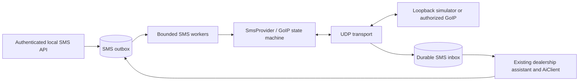

# GoIP SMS conversations and campaigns

This is a simulator-tested local integration. The physical VoiceLink GoIPx8, firmware `GST1610-1.01-70-18`, has not been contacted or reconfigured. Its existing SMS server remains outside this application's control. Enabling a listener does not redirect gateway traffic to it.

## Architecture and durability

SMS lives under `com.svi.channelconnect.sms`. `SmsService` validates submissions and commits an outbox record. `SmsProvider` isolates the provider; `GoipSmsProvider` owns the UDP implementation. `SmsMessagingChannel` registers the `SMS` channel with the existing `MessagingAppHandler`. The old fictional SMS demo adapter is used only when SMS integration is disabled; Telegram simulation is unchanged.



Flyway V4 adds inbox, outbox, scoped conversation state, a transaction lock, and a persistent session sequence. V5 adds an ordered inbox cursor for receive polling, and V6 persists the hosted API's initial receive baseline. Existing migrations and Meta HTTP contracts are preserved. This implementation supports **one application instance**, persistent H2 storage, and bounded queues. No new broker or database dependency is introduced. Local durability requires persistent writable storage; an in-memory database loses messages on restart.

Inbound acceptance commits before sending `RECEIVE receiveId OK` with LF. AI runs later on a bounded worker. A lost acknowledgement causes the gateway to retransmit; `(configured account, receive ID)` and a content fingerprint prevent a second processing attempt. Conflicting reuse of an ID is rejected without a success acknowledgement. Processing failures retry up to the configured limit, then enter `DEAD_LETTER`. Protected operations can list and retry retained dead letters.

The existing assistant is reused. Interpretation runs outside database transactions; business mutations, scoped workflow state, the reply outbox record, and inbound completion commit together. Retrying an unfinished receipt does not skip it because of the dealership history's duplicate check. Committed replies are reused, and uncertain sends are never automatically replayed. SMS context is scoped by account and normalized participant; private customer facts require explicit verified identity linking. The existing dealership schema currently permits one verified SMS identity per customer. Unknown identities on different SIM accounts remain separate; linking several SMS accounts to one customer requires a future identity-schema change.

Outgoing work starts `QUEUED`, becomes `CLAIMED`, and commits `TRANSMITTING` **before** the first recipient datagram. Terminal states are `GATEWAY_SENT`, `FAILED`, and `UNKNOWN`. On restart, claims with no transmission marker can resume; transmitting messages become unknown. This deliberately treats a crash between the transmission commit and the actual UDP send as uncertain. Exactly-once cellular delivery cannot be guaranteed by this protocol.

Campaign acceptance and cooldown scheduling begin only after `GATEWAY_SENT`. A queued campaign is rechecked for customer response, consent, opt-out, and authorization before transmission. The SMS API returns an application message ID; the shared adapter's existing `providerMessageId` field carries that application ID for SMS until the workflow has an actual gateway result. GoIP supplies session/recipient IDs, not a handset delivery receipt.

## Protocol reference and limits

Primary reference: the supplied 22-page **GOIP SMS Interface**, originally named `GoIP8 API 1 1.pdf`, SHA-256 `72E8B26B7ADA775DBFE1CD9EF37441FA78EF530FEDB05F2A1E0116DB3842B2DF`. Its packet definitions were inspected visually because embedded font mappings corrupt text extraction. The canonical repository location is `docs/reference/goip8-sms-interface.pdf`.

- Pages 1–2: authenticated `req:` registration/keepalive, approximately every 30 seconds; matching `reg:count;status:0;` acknowledgement. Availability requires a real authenticated exchange, GSM `LOGIN`, an unexpired registration, and an unambiguous endpoint mapping. An emitted UDP acknowledgement is server-side exchange evidence; it does not prove the device UI received it.
- Pages 3–8: `MSG`, gateway password challenge, password response, gateway `SEND` readiness, recipient `SEND`, `WAIT`/`OK`/`ERROR`, and request/confirmation `DONE`. Command packets use LF, not the two literal characters backslash and `n`.
- Content is measured in UTF-8 **bytes**, with a hard ceiling of 3000. Sessions have an absolute configured deadline no greater than 90 seconds, a maximum of five sessions per configured physical device, and a configurable limit per SIM (default one). Live mode requires one session per SIM until firmware concurrency is verified. The initial API sends one recipient per bulk session; it does not expose bulk fan-out. This avoids eviction from the documented ten-recipient status cache.
- Repeated recipient polls use the identical session ID, recipient sequence `1`, and number. Polls are bounded and stop after expiry or registration change. A fresh session is never created to retry an uncertain recipient submission. Lost initialization/authentication replies fail before recipient submission; those steps are not blindly retransmitted.
- Pages 9–10: incoming `RECEIVE:` headers followed by the complete `msg:` remainder. Spaces, colons, semicolons, and trailing newlines are preserved. The definition uses `password:` while its example uses `pass:`; either spelling is accepted, but both together are rejected. The protocol does not define delimiter escaping for credentials; configured credentials must not contain whitespace, colons, semicolons, or control characters.
- Read-only `get_gsm_num` and `get_gsm_state` are supported. `IDLE`/`ACTIVE` describes the queried line state, not SMS registration. No reboot, USSD, call control, IMEI modification, SIM configuration, or arbitrary command interface is provided.

`GATEWAY_SENT` records GoIP's `OK` result; **handset delivery remains unconfirmed**. The PDF does not document an SMS delivery-report exchange.

Cellular length policy is separate from UDP size. The validator counts GSM-7 extension characters as two septets and BMP Unicode as UCS-2 units, using the single-message limits in [ETSI TS 123 038, sections 4 and 6.2.1](https://www.etsi.org/deliver/etsi_ts/123000_123099/123038/16.00.00_60/ts_123038v160000p.pdf). Multipart estimates use conservative concatenation budgets; `max-segments` defaults to one and live mode requires one. No PDU construction or concatenation is implemented. Non-BMP characters are rejected for outbound content because firmware support is unknown. Simulator acceptance does not verify the gateway's alphabet selection, Unicode conversion, multipart behavior, or embedded-newline support. Overlong assistant replies produce a short fallback and an `SMS_RESPONSE_TOO_LONG` event rather than silent truncation.

## Configuration

Spring does not load `.env` automatically. Use environment variables, an external Spring configuration file, or `SPRING_APPLICATION_JSON`. Never place real credentials or numbers in committed settings.

| Environment variable | Default / purpose |
| --- | --- |
| `SMS_ENABLED` | `false`; creates no GoIP socket/provider when disabled |
| `SMS_PROVIDER_MODE` | `MOCK`; simulator is permitted only with `local`/`test` |
| `SMS_UDP_BIND_ADDRESS`, `SMS_UDP_PORT` | Loopback and ephemeral port; explicit private bind and nonzero port required for live |
| `SMS_LIVE_AUTHORIZED` | `false`; explicit live configuration gate, not a substitute for deployment approval |
| `SMS_API_TOKEN` | Required, at least 16 characters, for enabled local/test HTTP API |
| `SMS_REGISTRATION_TIMEOUT` | `90s` |
| `SMS_SESSION_TIMEOUT` | `80s`, at most `90s` |
| `SMS_PACKET_TIMEOUT`, `SMS_POLL_INTERVAL`, `SMS_MAX_POLLS` | `3s`, `3s`, `10` |
| `SMS_MAX_SESSIONS`, `SMS_QUEUE_CAPACITY` | `5`, `1000`; the per-SIM limit defaults to one |
| `SMS_MAX_CONTENT_BYTES`, `SMS_MAX_SEGMENTS` | `3000`, `1` |
| `SMS_PROCESSING_ATTEMPTS`, `SMS_PROCESSING_RETRY_DELAY` | `3`, `1s` |
| `SMS_QUEUE_EXPIRY` | `24h`; expired pending work becomes failed/dead-letter |
| `SMS_CONTENT_RETENTION`, `SMS_ID_RETENTION` | `30d`, `90d`; ID retention must cover content retention |
| `SMS_SHUTDOWN_TIMEOUT` | `10s` |
| `SMS_MOCK_AUTH_ID`, `SMS_MOCK_PASSWORD`, `SMS_MOCK_SIM_NUMBER` | Inputs for the convenience `sms-mock` profile; number is optional |

Configure `sms.channels` externally as a list. Each entry contains `account-id`, `device-id`, `sim-channel` (1–8), literal `source-address`, `auth-id`, `password`, optional normalized `sim-number`, `send-interval` (default `5s`), `sends-per-hour` (default `60`), and `max-concurrent-sessions` (default `1`, range `1–5`, restricted to `1` in live mode). One physical `device-id` must have one address and unique SIM channel numbers. `(source address, authentication ID)` must identify exactly one channel.

The PDF contains no explicit SIM selector in the SMS commands. Outbound sessions target the endpoint learned from the channel's authenticated registration. Two channel identities sharing an endpoint are made unavailable; inbound messages on ambiguous or unregistered routes are rejected. A changed endpoint, expired registration, or decreasing keepalive counter invalidates active sessions. If a gateway reports a SIM number different from the configured mapping, sending remains unavailable. These safeguards cannot establish firmware mapping by themselves: real-device packet capture and per-SIM verification are prerequisites for live use.

Hourly transmission attempts and minimum send intervals are persisted. Queue limits reject new work without a successful inbound acknowledgement. Normalized Philippine inputs include `09…`, `9…`, `639…`, and `+639…`; routine responses/logs omit full numbers, content, and passwords.

Content cleanup removes completed SMS content from the SMS tables and their dealership history copies. Completed inbox/outbox IDs expire after ID retention, allowing later ID reuse. **Unknown outbound idempotency tombstones remain indefinitely**, with content removed after content retention, so expiry cannot authorize an uncertain resend. Dead-letter content has the same configured retention; resolve or export failures before expiry. Protect the database volume and backups, and plan disk capacity for retained tombstones.

## Use the hosted GoIP8 Postman API

The operator's supplied collection uses two hosted PHP endpoints. `HTTP_API` mode follows its request format exactly:

- Send: `POST <send-url>?line=<SIM>&message=<encoded text>&number=<encoded local mobile>`, with an empty body.
- Receive: `GET <receive-url>?action=message&key=<encoded private key>`.

Set `SMS_GOIP_API_SEND_URL` and `SMS_GOIP_API_RECEIVE_URL` to the collection's endpoint paths **without their query strings**, plus `SMS_GOIP_API_RECEIVE_KEY`, `SMS_GOIP_GATEWAY_ID` (matching incoming `goip_id`), and `SMS_API_TOKEN`, privately in the launching terminal or external configuration. Run:

```powershell
.\mvnw.cmd spring-boot:run '-Dspring-boot.run.profiles=local,demo,sms-http-api'
```

The profile maps SIMs 1 and 2 to `goip-line-1` and `goip-line-2`. Add other accounts externally for additional lines. This mode uses HTTPS endpoint URLs and does not require direct gateway access, UDP reception, or a web-login password. Normalized outbound `+639...` numbers become `09...` for the collection's send contract; spaces, ampersands, newlines, and plus signs are URL-encoded. The operator confirmed this POST query request delivers SMS. Its observed response is an HTML management page without a correlated submission acknowledgement, so sends are recorded as `UNKNOWN / HTTP_API_SUBMISSION_UNCONFIRMED` after a successful HTTP response and are never automatically resent. Poll the customer's reply to continue; gateway HTTP success still does not confirm handset delivery.

The hosted receive worker runs continuously using `sms.poll-interval` (`SMS_POLL_INTERVAL`, default `3s`) with one bounded remote request at a time. It accepts the supplied `{success,count,messages}` envelope, matching `goip_id` and `channel` to a configured account. It uses `recvid` for durable account-scoped deduplication and preserves `received_at`; it ignores `raw_packet`, gateway credentials, and other diagnostic fields. Only verified linked identities with consent and outbound permission enter this campaign conversation path. Bank/OTP alphanumeric senders, unconfigured routes, and unrelated customer numbers are skipped.

On first activation, a database baseline excludes previously received messages so startup does not answer old inbox history. The default baseline uses second precision to match the supplied timestamps. The same baseline survives restarts, allowing messages since that activation to be imported when the API still exposes them. An optional external `sms.http-api.receive-start-at=<ISO instant>` sets the first baseline for an explicit backfill; changing it does not replace an existing baseline. The collection exposes a snapshot and no pagination/cursor contract, so messages absent from the snapshot cannot be recovered by this client. Keep polling frequency appropriate for its history window. HTTP failures, invalid envelopes, and queue exhaustion leave accepted receipts deduplicated for subsequent polls. Snapshots are limited to 1,000 messages and the response body is bounded by `SMS_GOIP_API_MAX_RESPONSE_BYTES` (default 1 MiB); larger snapshots are rejected. Private URLs, receive keys, raw packets, and customer content are excluded from operational logs.

`/api/v1/sms/receive` polls the retained **local** inbox populated by this worker; its calls do not issue extra gateway requests. Both `HTTP` web-form mode and UDP modes remain available below.

## Use the direct GoIP8 HTTP sender

The separate `HTTP` mode uses the same Basic Auth web form request as [generic-sms-sender](https://github.com/glenannang/generic-sms-sender): `POST /default/en_US/sms_info.html`. It uses `sms.channels[0].source-address` for `goip.ipaddress`, `auth-id` for `goip.user`, `password` for `goip.pass`, `sim-channel` for `goip.line`, and `sms.session-timeout` for `goip.timeout-seconds`. The tested line is 1. Configure the gateway address and credentials privately through environment variables or an external Spring config file; do not commit them.

The `sms-http` profile maps `SMS_GOIP_IPADDRESS`, `SMS_GOIP_USER`, `SMS_GOIP_PASS`, and optional `SMS_GOIP_TIMEOUT` (default `60s`) into that configuration. Set `SMS_API_TOKEN` privately too, then run `./mvnw.cmd spring-boot:run '-Dspring-boot.run.profiles=local,demo,sms-http'`. The existing outbound API and durable outbox then apply. The HTTP provider marks an HTTP 200 as `GATEWAY_SENT`, matching the reference sender's success criterion. This confirms only that the gateway web form responded successfully; verify handset delivery separately. Any non-200 response, timeout, or uncertain transport result becomes `UNKNOWN` and is not retried automatically. HTTP reception is opt-in through the documented UDP protocol; a firmware HTTP inbox URL has not been supplied.

Set those environment variables in the **same PowerShell terminal** that starts Maven. The `goipconfig.properties` file from the standalone sender is not loaded by this application, and `.env` is not loaded automatically. A missing channel value now reports its field name, such as `Invalid SMS channel auth-id`, without printing credentials.

For line 2, start with `local,demo,sms-http-two-lines` instead of `sms-http`. This profile configures `goip-line-1` and `goip-line-2` on one gateway using the same HTTP login. The profile makes no claim that line 2 has been verified on the physical device; test its routing with an approved handset.

For two-way HTTP-mode conversations, supply an external Spring configuration with the following properties, replacing placeholders privately:

```properties
sms.http-inbound.enabled=true
sms.bind-address=<listener private IP>
sms.port=<nonzero UDP port>
sms.http-inbound.channels[0].account-id=goip-line-1
sms.http-inbound.channels[0].auth-id=<line 1 SMS-server UDP ID>
sms.http-inbound.channels[0].password=<line 1 SMS-server UDP password>
sms.http-inbound.channels[1].account-id=goip-line-2
sms.http-inbound.channels[1].auth-id=<line 2 SMS-server UDP ID>
sms.http-inbound.channels[1].password=<line 2 SMS-server UDP password>
```

Use only the first entry for a one-line setup. `SMS_GOIP_RECEIVE_ENABLED=true`, `SMS_UDP_BIND_ADDRESS`, and `SMS_UDP_PORT` can supply the listener settings; channel credentials still belong in external configuration. UDP IDs must distinguish the SIMs and are independent of the shared HTTP web login. The gateway must be configured to register and deliver incoming SMS to this application's listener. Starting the application does not change the gateway's existing SMS-server destination. Incoming replies are persisted and answered through the HTTP account for the same SIM. HTTP-mode UDP channel-status/query and simulator administration routes remain unavailable.

## Run the loopback simulator


Use a separate PowerShell terminal. The recipient below is fictional and is used only by the in-process loopback simulator:

```powershell
$env:SMS_API_TOKEN = [Guid]::NewGuid().ToString('N')
$env:SMS_MOCK_AUTH_ID = 'local-sim-1'
$env:SMS_MOCK_PASSWORD = [Guid]::NewGuid().ToString('N')
$env:AI_PROVIDER = 'mock'
.\mvnw.cmd spring-boot:run '-Dspring-boot.run.profiles=local,demo,sms-mock'
```

The `demo` profile supplies offline placeholders for inactive connectors and binds HTTP to loopback. Do not enable campaign scheduling or live Meta credentials merely to exercise SMS. The application starts its loopback UDP listener and one simulator peer for each configured channel. The simulator performs registration, password authentication, sending, status polling, session closure, inbound retransmission, and acknowledgements; it cannot send cellular SMS.

Supply additional mock channel entries through external configuration/`SPRING_APPLICATION_JSON` if testing multiple SIMs. All simulator addresses must be loopback. The Java simulator offers fault modes for rejected authentication, dropped challenges/readiness/results, `WAIT`, recipient errors, lost inbound acknowledgements, and duplicate/retransmitted packets. These hooks are exercised by tests and do not expose an arbitrary-packet public API.

## Application API and Postman

Import [the local Postman collection](postman/goip-sms-local.postman_collection.json). Set `smsApiToken`, `adminUsername`, and `adminPassword` privately. Its base URL is loopback. Existing WhatsApp routes are unchanged.

Submit `POST /api/v1/sms/send` (or the compatible `/api/v1/sms/messages`), using `Authorization: Bearer <SMS_API_TOKEN>`, `Idempotency-Key: <stable request key>`, and JSON:

```json
{"accountId":"mock-sim-1","recipient":"+639000000001","content":"Local protocol test"}
```

The response is `202`, with a `Location` status URL:

```json
{"messageId":"<application UUID>","status":"QUEUED","replay":false}
```

`GET /api/v1/sms/messages/{messageId}` requires the same bearer credential and returns message status, a safe `errorCode` when present, and `handsetDelivery: UNCONFIRMED`. Reusing a key with identical normalized inputs returns the original message and `replay: true`; changed inputs return `409`. Validation returns `400`, unknown accounts or revoked customer authorization return `403`, queue exhaustion returns `503`, and request bodies larger than 16 KiB return `413`. The SMS API accepts any valid Philippine mobile number; there is no SMS recipient allowlist. Keep the bearer token private because it can authorize sends to any such number.

`content` is the final customer-facing text supplied by a caller, including an already produced LLM reply. `/send` does not call the LLM. Do not send the interpreter's internal intent JSON as SMS content. The automatic conversation worker already generates and enqueues one reply for each inbound receipt; manually submitting the same reply with a different key creates an additional outbound SMS.

Poll `GET /api/v1/sms/receive?accountId=goip-line-1&after=0&waitSeconds=25` with the same bearer token. Optional `sender` filters one normalized customer; `limit` is 1–100 (default 100). `waitSeconds` is 0–30 (default 25). Empty polls wait asynchronously, with at most 100 concurrent waiting requests, and return `200` with an unchanged cursor at timeout. A response looks like:

```json
{
  "messages": [{"cursor": 12, "messageId": "<inbox UUID>", "receiveId": 87,
    "sender": "+639000000001", "content": "Friday at 9am", "receivedAt": 1791939600000,
    "status": "RECEIVED"}],
  "nextCursor": 12
}
```

Repeat the request with `after=nextCursor` to keep waiting for new messages. Save the cursor after processing a page and keep the same account/sender filters. Polling is read-only: it does not claim receipts, invoke AI, or delete messages. The automatic worker may advance the reported processing status independently. Receipts remain replayable while retained; retained content and IDs follow the cleanup settings above. A newly accepted receipt may appear before its AI reply is queued.

## Appointment assistant and mass outreach

Import customer profiles through `POST /api/admin/demo/customers/import`, then link each verified SMS identity through `POST /api/admin/demo/customers/{customerId}/identities`. For enabled GoIP, use its configured account (for example `goip-line-1`) and a normalized Philippine number as `externalId`, with verified ownership, consent, and outbound permission. These admin routes require HTTP Basic authentication.

```json
{"channel":"SMS","accountId":"goip-line-1","externalId":"+639000000001",
 "verified":true,"consent":true,"outboundAllowed":true}
```

Start canned outreach to a list using `POST /api/admin/demo/campaigns/bulk`:

```json
{"customerIds":["demo-renewal","demo-booking"],"baseChannel":"SMS","openingScript":"script3"}
```

The request accepts up to 100 unique customer IDs; send larger lists in batches. `openingScript` selects `script1` or `script3` from the campaign manager's configured `scripts` map and is also supported on `/api/admin/demo/campaigns/start`. An optional `configuration` supplies a complete campaign snapshot. The bundled scripts are sample openings; replace them with approved campaign wording and keep rendered SMS within the configured length limit. Omitting selection preserves the existing opening. Initial campaign sending does not call the LLM. Repeating a start for the same campaign/customer reuses the execution and selected script. Results are per customer: `execution` contains the durable campaign state, or `errorCode` explains an individual rejection. Queueing is separate from gateway acceptance and handset delivery. Existing SIM sending intervals, hourly limits, consent checks, opt-out, and suppression after a reply still apply.

After a customer responds, the assistant receives every retained processed inbound and transmitted outbound turn for that account/participant, including the opening; the previous 20-message truncation is removed. Failed and unsent outbound messages are excluded, and uncertain transmissions carry their delivery status. Other SIM/customer conversations remain isolated. The prompt also includes verified customer/vehicle facts, active campaign, workflow, current appointment, and available slots. Retention cleanup still bounds how far history can reach; model/provider input limits still apply.

The supplied TMBG material is implemented as configurable deterministic facts and intent branches in `dealership/catalog.json` and the assistant prompt: PMS inclusions, insurance support, LTO concierge, bundle benefits, dealer value, price objections, waiting time, essential-only estimates, broker comparison, and DIY registration. The LLM returns a structured intent; application code chooses approved wording and commits booking decisions. Rates, warranty outcomes, resale premiums, guaranteed turnaround, and legal penalties are not invented. SMS uses concise approved variants within the single-segment default; longer catalog answers remain available on the other channels.

Appointments require a verified linked customer, an eligible configured service, and an available capacity-controlled slot. Unavailable dates trigger another-date prompts. Bundled slots and profiles are fictional, and booking records do not reserve a real dealership bay. CRM context currently comes from the existing profile import/link flow; Redshift ingestion/writeback and a live dealership scheduling adapter are not implemented. Configure actual catalog facts, customer offerings, and slots before a live pilot.

HTTP Basic admin authentication protects:

- `GET /api/admin/sms/channels`: registration age, availability, signal, and configured SIM channel.
- `GET /api/admin/sms/channels/{account}/query`: read-only line-state query.
- `POST /api/admin/sms/simulator/receive`: mock-only ingress, e.g. `{"accountId":"mock-sim-1","sender":"+639000000001","content":"What are your opening hours?"}`. This sends an actual UDP packet into the application; the API returns before AI processing.
- `GET /api/admin/sms/inbound/dead-letters`: up to 100 failure records, without customer content or numbers.
- `POST /api/admin/sms/inbound/{messageId}/retry`: explicitly retry a retained processing failure after fixing its cause. This cannot retry an unknown outbound transmission.

All these HTTP endpoints remain restricted to `local`/`test`. An admin can link an externally configured SMS account to a verified customer through the existing identity endpoint. The fictional `/api/admin/demo/replies` route refuses SMS ingress when the UDP integration is enabled. Legacy demo campaigns using `demo-*` SMS identities remain for SMS-disabled demos; enabled GoIP mode requires configured SMS identities and SMS-sized scripts.

## Verification and operations

```powershell
.\mvnw.cmd '-Dtest=GoipPacketCodecTests,SmsPropertiesTests,SmsValidationTests,GoipRegistrationServiceTests,GoipSmsSessionManagerTests,SmsPersistenceTests,GoipSmsIntegrationTests' test
.\mvnw.cmd test
.\mvnw.cmd clean verify
```

Tests use only literal loopback UDP peers, synthetic numbers, fake credentials, isolated databases, and mocked Meta/OpenAI boundaries. Coverage includes framing and UTF-8 byte lengths, credential rejection, channel ambiguity/expiry, correlation, concurrency/deadlines, packet loss, actual inbound retransmission, durable deduplication, database reopen, unknown-outcome recovery, existing AI routing, transactional business rollback, protected APIs, and campaign queue/result handling. Existing WhatsApp tests remain the regression suite.

Micrometer exposes `sms.goip.packets`, `sms.goip.registrations`, `sms.goip.sessions`, `sms.goip.available.channels`, `sms.inbound`, `sms.inbox.backlog`, `sms.outbox.backlog`, `sms.processing`, and `sms.outbound`. Labels are bounded result categories; customer numbers/content are not labels. Counters record retries, rejected packets, dead letters, and unknown sends. Inbound receipt continues during an AI failure until durable capacity is exhausted. Graceful shutdown stops claims, waits for bounded workers, closes sockets, and leaves interrupted transmission markers for recovery. Check both gateway connectivity and database/backlog capacity; application liveness does not establish SIM availability.

## Separate hardware deployment and cutover

Do not execute this checklist without explicit hardware authorization. No step below was performed by this implementation.

1. Identify the owner of the gateway's existing SMS server, agree a maintenance window, and obtain network, gateway, credential, SIM, and approved-recipient sign-offs. Do not take over an occupied port or redirect existing traffic unilaterally.
2. Record current per-channel settings and prepare an operator-owned rollback copy outside source control. Agree exactly which channels may be temporarily reassigned, and who changes/restores them.
3. Provide private LAN/VPN reachability and firewall rules allowing only approved gateway addresses to the dedicated UDP listener. No public UDP exposure, NAT assumption, or automatic endpoint discovery is permitted. Confirm the application bind address, port, reply path, persistent database volume, restricted credentials, and backup procedures.
4. Resolve registration IDs, passwords, source ports, SIM numbers, and physical channel mapping with an authorized packet capture. If identities/endpoints cannot distinguish SIMs, stop: automatic replies and live sending must remain disabled.
5. Configure live mode explicitly using external secrets, `SMS_ENABLED`, a private bind, fixed port, and `SMS_LIVE_AUTHORIZED`. The flag only permits configured startup; it does not constitute human approval. A production application still needs its existing durable WhatsApp dispatcher and reviewed production API/administration infrastructure.
6. An authorized operator changes only the agreed test channel's server destination. Verify registration on both server and gateway before any send. Begin with one approved recipient and one GSM-7 message; verify receipt on the handset independently of GoIP `OK`.
7. Verify each authorized channel's inbound identity and same-SIM reply, Unicode conversion, multiline bodies, recipient normalization, registration expiry/reboot behavior, polling duplicates, timeouts, shutdown/restart recovery, and actual sending limits. Multipart operation remains disabled pending a separately reviewed firmware result.
8. On unexpected mapping, registration failure, duplicate transmission, or uncertain outcome, disable new work. Preserve the ledger and diagnostic metadata. Do not retry unknown sends. The responsible operator restores the saved destination/settings and confirms the original server's registration before ending the maintenance window.

Production sign-off requires successful authorized physical-device tests, measured registration/send timings, a verified SIM-routing inventory, private-network controls, database durability/backups and capacity, dead-letter/unknown-outcome procedures, operational alerts, rollback evidence, and resolution of the existing application's production dispatch limitations. Simulator success does not establish production readiness.
